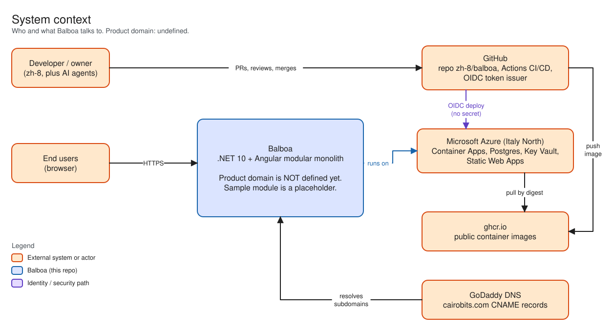
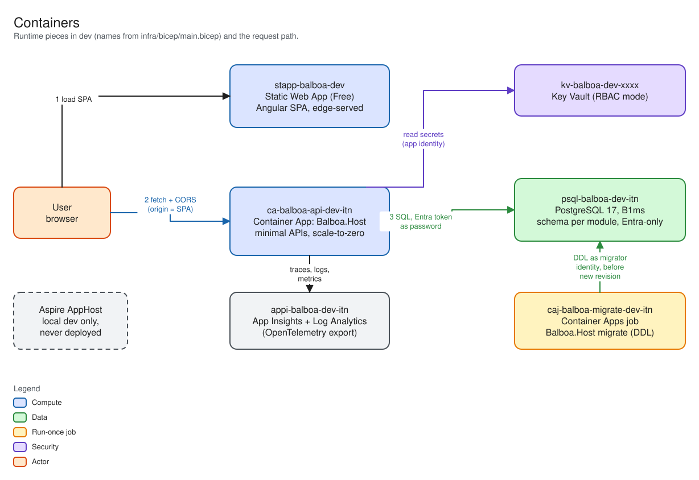
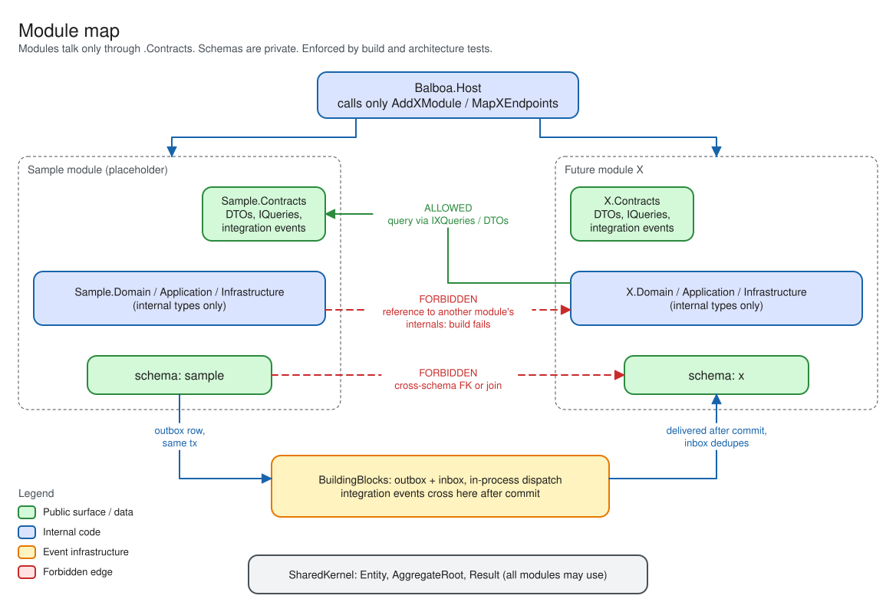
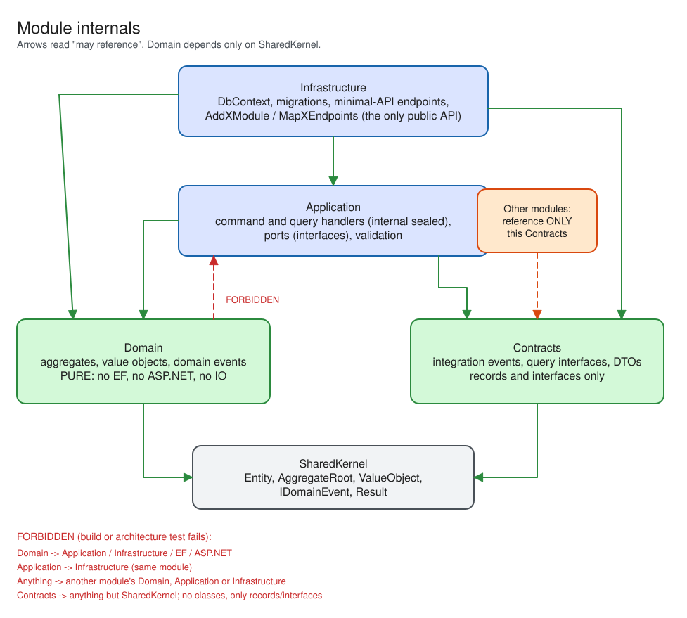
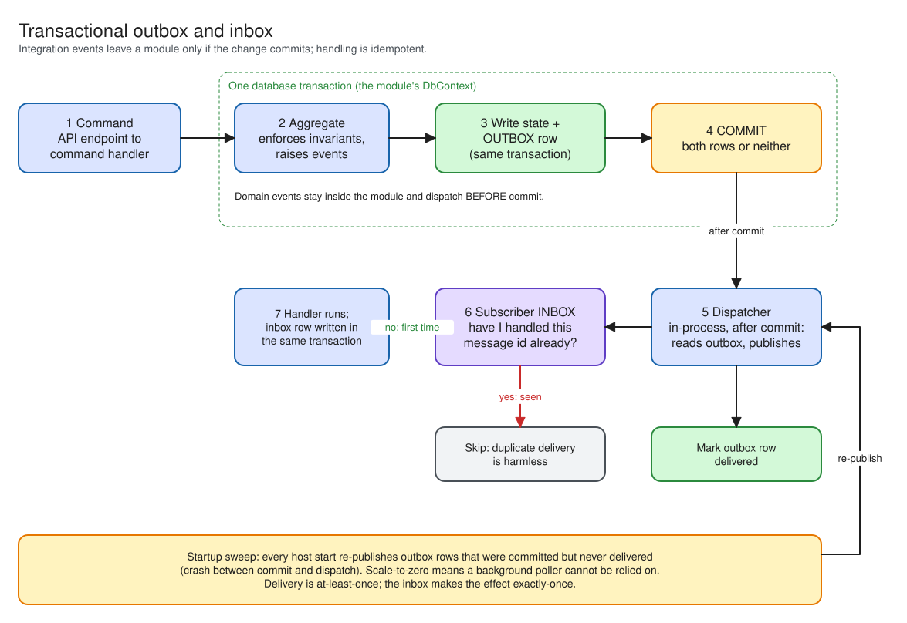
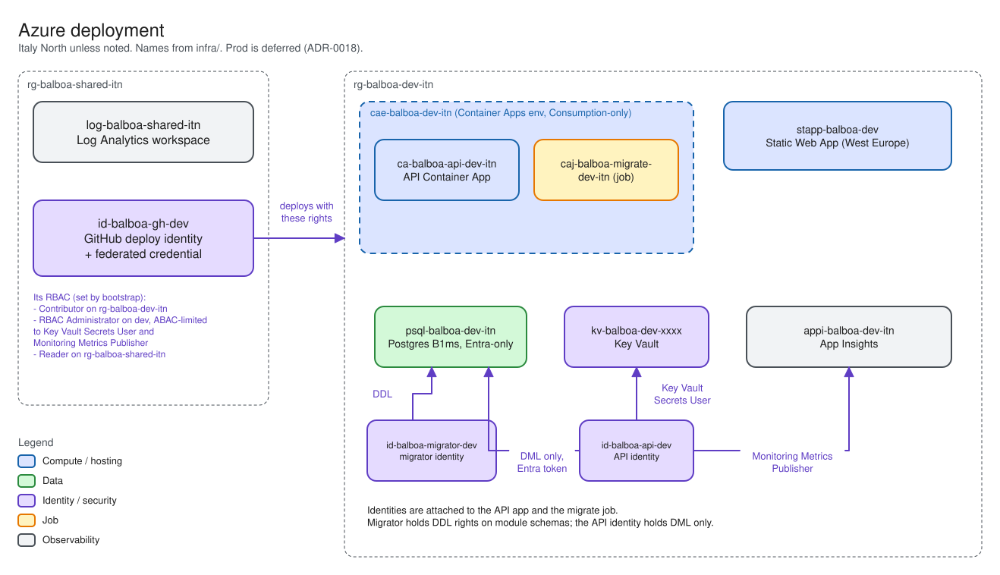
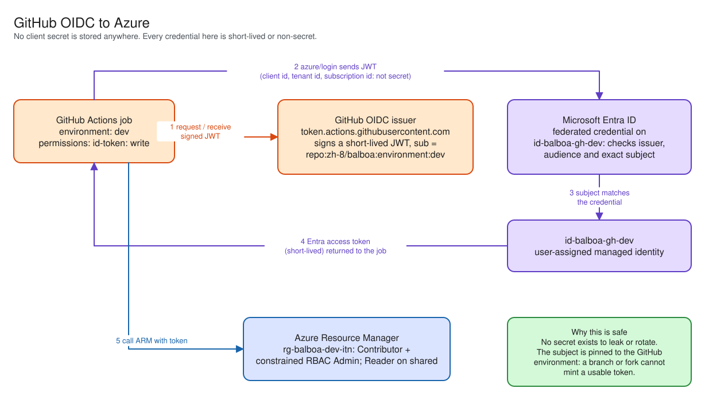
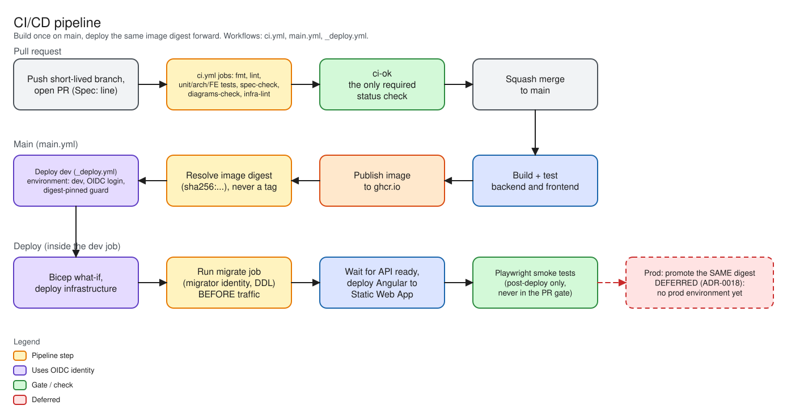
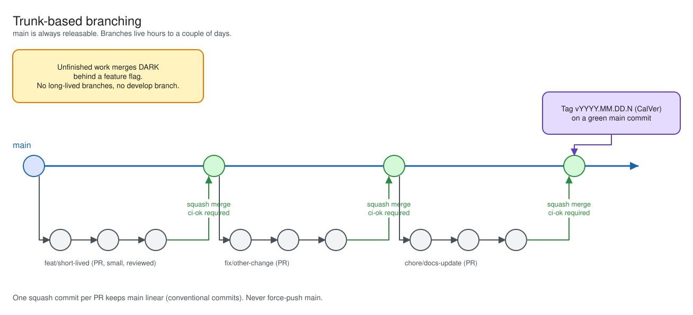
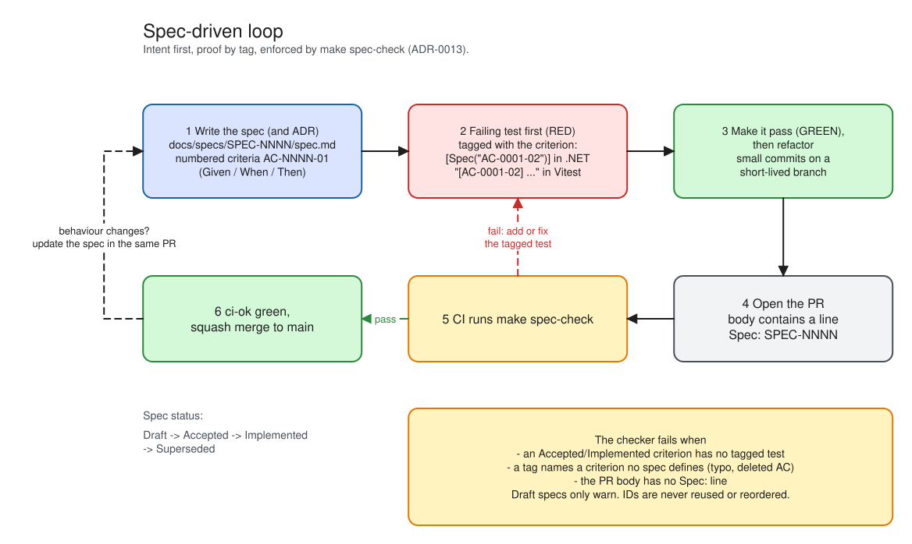

# Architecture overview

## 1. What Balboa is

Balboa is a .NET 10 and Angular **modular monolith** deployed to Azure Container Apps. It is
built with DDD, TDD, trunk-based development and spec-driven development.

**The product domain is not yet defined.** `backend/src/Modules/Sample/` is a placeholder
that demonstrates the module pattern ([SPEC-0001](../specs/SPEC-0001-sample-module/spec.md)).
It will be replaced by the first real bounded context. Everything below describes the
architecture and its tooling, which are real, not a product.

Diagrams below are generated from Excalidraw sources in `diagrams/` by `make diagrams`.
Until the first export, the image links will be broken. `make diagrams-check` verifies they
are current ([ADR-0015](../adr/0015-excalidraw-diagrams.md)).

_System context: Balboa, its users, GitHub, Azure and the DNS provider._

## 2. Approach

| Principle | How it shows up | ADR |
|---|---|---|
| Modular monolith | One deployable, `Balboa.Host`; modules inside it | [0002](../adr/0002-modular-monolith-with-ddd.md) |
| DDD | One module per bounded context; pure Domain | [0002](../adr/0002-modular-monolith-with-ddd.md) |
| TDD | Failing test first; fast Docker-free gate | [0014](../adr/0014-test-strategy.md) |
| Trunk-based | Short branches, squash merge, flags | [0012](../adr/0012-trunk-based-development.md) |
| Spec-driven | Specs with `AC-NNNN-NN` criteria tied to tests | [0013](../adr/0013-spec-driven-development.md) |

_Containers: Static Web App, API container, migrator job, Postgres, and the local-only
docker compose database._

## 3. Modules

A module is a bounded context made of four projects under
`backend/src/Modules/<Context>/`.

| Project | Contents | May depend on |
|---|---|---|
| `*.Contracts` | Integration events, query interfaces, DTOs (records and interfaces only) | `SharedKernel` |
| `*.Domain` | Aggregates, value objects, domain events | `SharedKernel` only |
| `*.Application` | Command and query handlers, ports | Own Domain and Contracts, other modules' `Contracts`, BuildingBlocks |
| `*.Infrastructure` | `DbContext`, migrations, endpoints, `AddXModule` and `MapXEndpoints` | Own projects, other modules' `Contracts` |

Shared projects: `Balboa.SharedKernel` (Entity, AggregateRoot, ValueObject, IDomainEvent,
Result), `Balboa.BuildingBlocks` (handler abstractions, outbox and inbox, EF conventions),
`Balboa.ServiceDefaults` (OpenTelemetry, health, resilience). Local development runs the
Host against a Postgres container started by `backend/docker-compose.yml`; Aspire was
deferred because its restore would not complete on this network (ADR-0019).

_Module map: modules, their Contracts, and the only permitted dependency directions._

_Module internals: the four projects of one module and the direction of their references._

### Boundary enforcement

Boundaries fail the build rather than a code review
([ADR-0003](../adr/0003-three-layer-boundary-enforcement.md)). Three layers, fastest
feedback first:

1. **MSBuild guard** (`backend/Directory.Build.targets`): a project reference from one
   module to another fails unless the target is a `.Contracts` project; `*.Domain` may
   reference only `SharedKernel`.
2. **ArchUnitNET tests** (`Balboa.ArchitectureTests`): Domain free of EF and ASP.NET;
   Application free of Infrastructure; Contracts contain only records and interfaces; Host
   touches only `AddXModule` and `MapXEndpoints`; each `DbContext` maps only its own
   entities; handlers are `internal sealed`.
3. **Visibility**: implementation types are `internal`; `InternalsVisibleTo` only for a
   module's own sibling projects and tests.

## 4. Data

- One PostgreSQL 17 database, **one schema per module**, one `DbContext` per module with its
  own migrations history table inside that schema
  ([ADR-0005](../adr/0005-postgresql-schema-per-module.md)).
- **No cross-schema foreign keys and no cross-schema joins.** Modules reference each other by
  ID only.
- Migrations are applied by a dedicated job (`Balboa.Host migrate`) running under a separate
  migrator identity, before a new revision takes traffic. The API's database role has no DDL
  rights ([ADR-0010](../adr/0010-entra-only-postgres-authentication.md)).
- Integration tests run against `postgres:17` in Testcontainers using the real migrations.

## 5. Inter-module communication

| Need | Mechanism |
|---|---|
| Inside a module | `ICommandHandler<T>` and `IQueryHandler<T,R>` from DI, wrapped by Scrutor decorators |
| Read another module | A query interface published in that module's `.Contracts` |
| Tell another module something happened | Integration event via the transactional outbox |

**No MediatR** ([ADR-0004](../adr/0004-in-process-handlers-no-mediatr-outbox.md)).

- Domain events stay inside the module and dispatch before commit.
- Integration events are written to the module's outbox table in the same transaction as the
  aggregate change, then delivered in-process after commit.
- Subscribers record handled events in an inbox table, making handling idempotent.
- A startup sweep drains leftovers, because under scale-to-zero a background poller cannot be
  relied on.

_Outbox flow: aggregate change and outbox row in one transaction, delivery, and inbox
deduplication._

## 6. Request path

1. A user opens the Angular app, served from the Static Web Apps edge.
2. The SPA calls the API on its own subdomain over HTTPS (CORS allows the SPA origin).
3. Container Apps ingress routes to a replica of `Balboa.Host`, starting one if scaled to
   zero (cold start).
4. A minimal-API endpoint (mapped by a module's `MapXEndpoints`) builds a command or query and
   resolves its handler from DI. Decorators apply logging, validation and the unit of work.
5. The handler loads or changes an aggregate through the module's `DbContext`, which connects
   to Postgres with an Entra token (no password).
6. Integration events, if any, are committed to the outbox with the change and delivered after
   commit.
7. Telemetry flows to Log Analytics via OpenTelemetry from `ServiceDefaults`.

## 7. Deployment topology (planned)

The Azure environment does not exist yet; see section 9.

| Concern | Choice | ADR |
|---|---|---|
| Region | Italy North (`itn`); fallback Germany West Central, then West Europe | [0008](../adr/0008-region-italy-north.md) |
| API | Container Apps, Consumption-only environment, scale-to-zero | [0006](../adr/0006-container-apps-consumption-only.md) |
| Frontend | Static Web Apps Free, hosted in West Europe | [0007](../adr/0007-angular-on-static-web-apps-free.md) |
| Database | Postgres Flexible Server B1ms, Entra-only auth | [0005](../adr/0005-postgresql-schema-per-module.md), [0010](../adr/0010-entra-only-postgres-authentication.md) |
| Images | ghcr.io (public) | [0016](../adr/0016-ghcr-instead-of-acr.md) |
| Network | Public endpoints, no VNet or private endpoints in phase 1 | [0011](../adr/0011-no-vnet-in-phase-1.md) |
| IaC | Bicep, layered, `{type}-balboa-{env}-itn` naming | [0017](../adr/0017-bicep-layering-and-naming.md) |
| CI/CD | GitHub Actions, OIDC to user-assigned managed identities | [0009](../adr/0009-github-oidc-user-assigned-managed-identities.md) |

_Azure deployment: resource groups, Container Apps environment, job, Postgres and SWA._

_OIDC flow: GitHub token exchanged for an Azure token through a federated credential._

_CI/CD pipeline: PR checks, merge to main, image build, migrate job and revision deploy._

_Branching flow: short-lived branches, squash merge to main, CalVer tag._

_Spec-driven loop: spec, failing tagged test, code, `make spec-check`, merge._

### Custom domains

`cairobits.com` uses GoDaddy nameservers, so subdomains are CNAME records added there and no
Azure DNS zone is needed.

| Environment | Frontend | API | Status |
|---|---|---|---|
| dev | `dev.balboa.cairobits.com` | `api.dev.balboa.cairobits.com` | Planned |
| prod | `balboa.cairobits.com` | `api.balboa.cairobits.com` | Deferred |

## 8. Environments

| Environment | State | Notes |
|---|---|---|
| local | Available | `make run` starts the API against a Postgres container (ADR-0019) |
| dev | Planned, blocked | Resource group `rg-balboa-dev-itn`; budget $10/month |
| shared | Planned, blocked | `rg-balboa-shared-itn` for cross-environment resources |
| prod | **Deferred** | Not created until the first real feature ([ADR-0018](../adr/0018-defer-production-environment.md)) |

Expected dev cost after the subscription upgrade is about $0 per month, from the Container
Apps free grant (180,000 vCPU-s, 360,000 GiB-s, 2M requests per month), Postgres B1ms
(750 hours and 32 GB free for 12 months), SWA Free, 5 GB per month of Log Analytics and
ghcr.io. These are Azure's published allowances and may change.

Two cost traps are encoded in Bicep and must not be undone: the Container Apps environment
must stay Consumption-only (a workload-profile environment costs about $95 per month), and
only one Postgres B1ms fits the free 750 hours.

`rg-cairobits` and the `cairobits` Static Web App belong to an unrelated project in the same
subscription and must never be named, scoped or touched by Balboa tooling.

## 9. Current status

| Phase | Scope | State |
|---|---|---|
| A | Local: solution skeleton, Sample module, tests, tooling, docs, CI definitions | **Complete** |
| A10 | Public repository, branch ruleset, security settings, `dev` environment | **Complete** |
| B | Azure: bootstrap, dev environment, first deploy | **Blocked** on a subscription upgrade |

`zh-8/balboa` is live. `main` carries a `main-protection` ruleset: pull request required
(0 approvals, review threads must resolve, squash-only), `ci-ok` as the one required status
check with strict up-to-date enforcement, linear history, and no deletion or force-push.
Repository admins may bypass, but only through a pull request. Secret scanning and push
protection, Dependabot alerts and security updates, and private vulnerability reporting are
all on. The `dev` environment only accepts deployments from the protected default branch.

There is deliberately **no `prod` environment yet**: the deploy workflow takes the
environment name as an input, so an attempted prod deploy fails closed rather than
provisioning something nobody has reviewed.

The Azure subscription (its id and tenant id are kept out of this public repository — see
`infra/bootstrap/.env.example`) is in the `Warned` state: the free trial's $200
credit expired around 2026-10-15, the balance is $0 and the spending limit is on. A Warned
subscription can read and delete resources but cannot create them. Phase B needs an upgrade
to pay-as-you-go, which is a billing change the owner must make; tooling must not attempt
it. The 12-month free-services window runs to 2027-10-15.

The GitHub repository `zh-8/balboa` (public) has not been created yet.

The runbooks in [`../runbooks/`](../runbooks/) describe the planned setup and have not been
exercised against real resources.

## 10. Decisions

All architectural decisions are recorded in [`../adr/`](../adr/); see the index in
[`../README.md`](../README.md).
